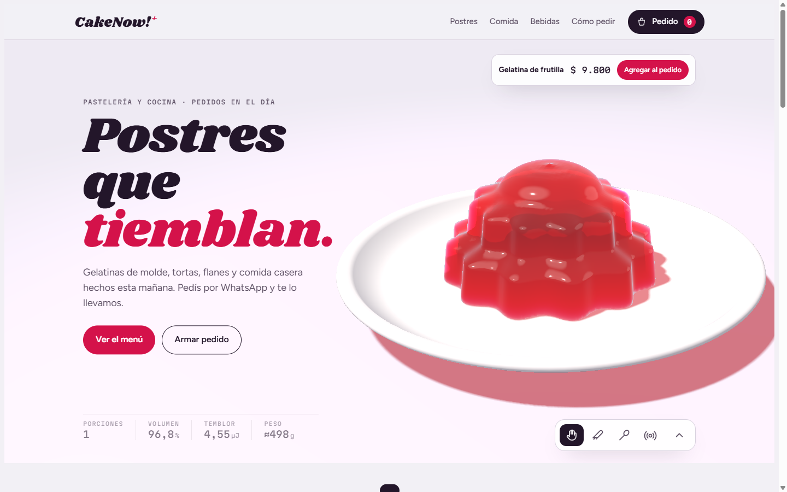

# CakeNow!+

Tienda de pastelería y comida casera con carrito y pedido por WhatsApp. La portada es una **gelatina de molde en 3D que tiembla de verdad**: se puede tocar con la mano, golpear, cortar con cuchillo y comer con cuchara.



## Cómo está hecha

- **Render 3D con WebGPU** (shaders WGSL propios en `src/gpu/`).
- **Física de cuerpo blando** que corre en un Web Worker (`src/worker.js`, `src/sim.js`) para no trabar la página.
- **Herramientas**: mano, cuchillo (corta en cualquier ángulo), cuchara (saca porciones con migas) y golpe.
- **Tienda**: 10 postres, comida y bebidas, dulce o crema como acompañamiento, carrito y pedido armado por WhatsApp (`src/shop/`).
- Responsive para celular. Sin frameworks: JavaScript puro empaquetado con esbuild.

## Correrlo local

```bash
npm install
node tools/build.mjs          # genera index.html y dist/cakenow.html (un solo archivo)
python -m http.server 8000    # abrir http://localhost:8000
```

Necesita un navegador con WebGPU (Chrome o Edge actuales).

## Tests

```bash
node tests/physics.test.mjs
node tests/desserts.test.mjs
node tests/spoon.test.mjs
node tests/knife.test.mjs
node tests/knife-screen.test.mjs
```
